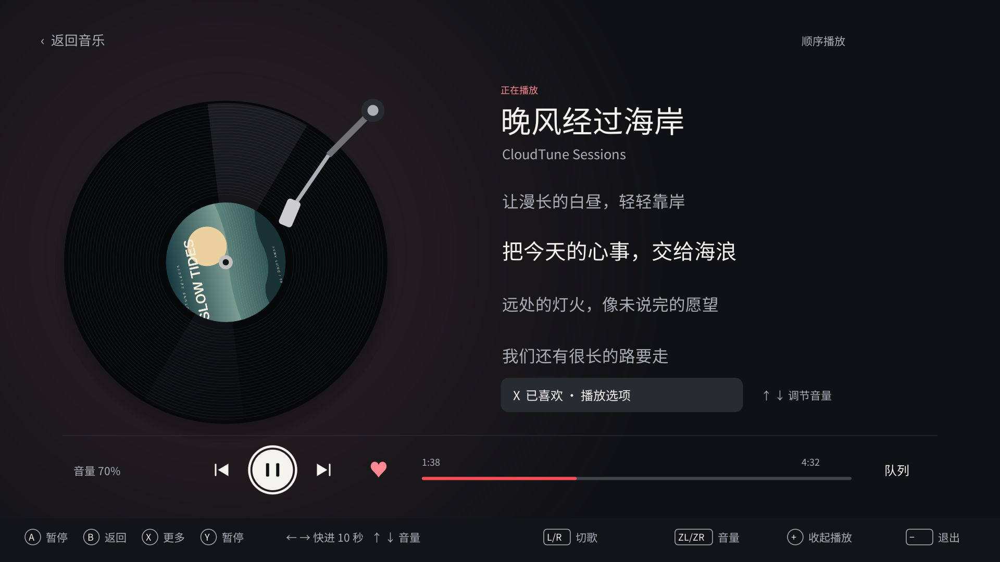
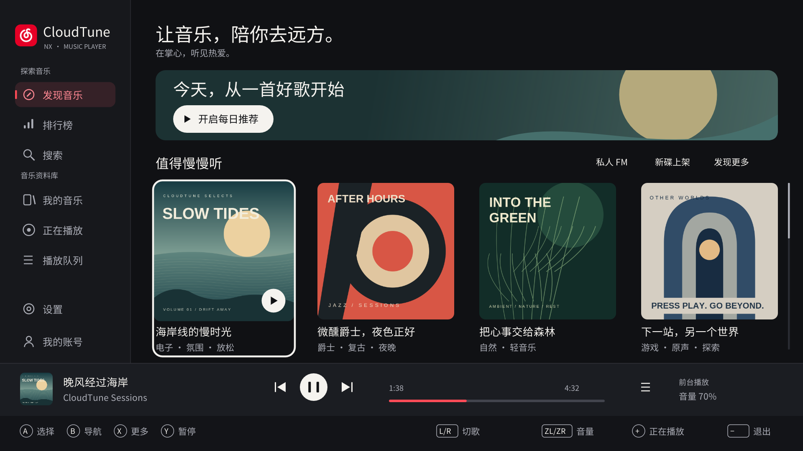

<p align="center"></p>
<h1 align="center">CloudTune NX</h1>

<p align="center">在掌心，听见热爱。<br>面向 Nintendo Switch 自制系统的原生网易云音乐客户端。</p>

<p align="center">
  <a href="https://github.com/tiansongyu/cloudtune-nx/actions/workflows/ci.yml"></a>
  <a href="https://github.com/tiansongyu/cloudtune-nx/releases"></a>
</p>

**v0.2.15** · 修复后台已就绪、覆盖层可连接，但前台因额外创建服务管理器会话而报 `0x10801` 的问题；保留受限内存启动与独立后台服务。支持扫码登录、多账号、黑胶播放器和 AirPlay 1。
Atmosphère 与游戏同时播放等场景仍需 Switch 实机验收，详见[验证记录](docs/VALIDATION.md)。

## 下载

**[下载 v0.2.15 SD 卡安装包](https://github.com/tiansongyu/cloudtune-nx/releases/download/v0.2.15/CloudTuneNX-0.2.15-sd.zip)**

[发布说明与全部附件](https://github.com/tiansongyu/cloudtune-nx/releases/tag/v0.2.15) ·
[SHA-256 校验文件](https://github.com/tiansongyu/cloudtune-nx/releases/download/v0.2.15/SHA256SUMS)

安装请选择 `CloudTuneNX-0.2.15-sd.zip`；GitHub 的 Source code 压缩包不含可运行程序。
`-symbols.zip` 用于崩溃排查，`-docs.zip` 用于离线阅读，无需复制到 SD 卡。

<p align="center">
  
</p>

<details>
  <summary>查看发现音乐界面</summary>
  <p align="center">
    
  </p>
</details>

*截图更新于 2026-10-21，来自实际 Borealis 桌面视图的 1920 × 1080 测试场景；曲目、歌词与封面为原创演示数据。双分辨率截图与验证边界见[原生界面验收](docs/design/cloudtune-nx/implementation.html)。公开版不包含私人照片。*

## 功能

- **界面与手柄**：1280×720 / 1920×1080、白色焦点、返回恢复位置；设置中支持减少动态和 95% / 90% 安全区。
- **发现与资料库**：搜索、歌单、排行榜、专辑、歌手、电台、每日推荐、私人 FM、收藏与音乐云盘。
- **二维码与多账号**：用网易云音乐手机 App 扫码；在设置中添加、切换或移除本机保存的账号。
- **黑胶播放器**：播放时以 20 秒一圈匀速旋转，暂停时停转；支持同步歌词、封面、进度跳转、随机和循环。
- **自动识别音频**：支持 MP3、FLAC、AAC（ADTS / M4A），按文件内容选择解码器，支持 HTTPS 流式播放和 SD 缓存。
- **后台与覆盖层**：独立服务负责音频，Tesla 覆盖层提供游戏内播放控制；服务不可用时可前台播放。
- **AirPlay 1 接收**：同一局域网的设备可向 Switch 投送音频，无需登录网易云账号。

## 安装与首次使用

需要可运行自制程序的 Nintendo Switch、Atmosphère、Homebrew Menu 和网络连接。
游戏内控制还需 Tesla 或兼容的覆盖层加载器；个人资料库需要网易云音乐账号。

1. 下载 SD 卡安装包和 `SHA256SUMS`，校验安装包完整性。已有安装时先备份数据目录。
2. 将 **SD 卡包中的内容复制到 SD 卡根目录**，合并 `switch/`、`atmosphere/`、`config/`。
3. 旧版升级先移除 `atmosphere/contents/42000000004E434D/flags/boot2.flag`，再重启主机。新版安装包默认不启用开机自启，打开 NRO 时按需启动后台。
4. 按住 **R** 启动一个游戏进入 Homebrew Menu，以完整应用内存打开 **CloudTune NX**。
5. 进入「我的账号」扫码并在手机上确认，再从「我的音乐」选择歌曲，确认播放与进度正常。

将安装包与校验文件放在同一目录，可用以下命令校验：

```bash
sha256sum --check --ignore-missing SHA256SUMS
```

确认输出包含 `CloudTuneNX-0.2.15-sd.zip: OK`。其他系统可使用支持 SHA-256 的校验工具。

播放栏显示 **「BGM · 后台服务」** 后，才可退出 NRO 并打开游戏。
通过覆盖层加载器打开 **CloudTune NX** 即可继续控制播放。
若显示「前台播放」，退出应用会停止音频；覆盖层本身不提供后台服务。

**更新时保留 `config/netease-switch/` 中的账号、设置和缓存。**
**如果复制旧版完整包后无法开机**，先将上述 `boot2.flag` 改名为 `boot2.flag.disabled`，再尝试开机。覆盖新版 ZIP 不会自动删除旧标志文件。详见[开机崩溃恢复](docs/INSTALLING.md#recover-a-console-that-crashes-during-boot)。

v0.2.9 的实机复测仍出现 AM `2001-0132`（资源配额不足），即使 CloudTune 日志已到达 `ready`。v0.2.15 在 HOME 创建后继续观察资源余量，运行中限制堆增长并回收可释放的堆尾；保留开机自启能力。具体主机仍需复测，详见[本次修复与验证边界](docs/releases/v0.2.15.md)。

每次同步更新客户端 `CloudTune.nro`、后台服务 `exefs.nsp` 和覆盖层 `CloudTune.ovl`，然后重启。
完整安装路径、启动方式与排错见[安装指南](docs/INSTALLING.md)。

## 常用操作

| 操作 | 按键 |
| --- | --- |
| 移动 / 选择 / 返回 | 方向键或左摇杆 / A / B |
| 页面选项、分类与收藏 | X |
| 播放 / 暂停 | Y |
| 上一首 / 下一首 | L / R |
| 调低 / 调高音量 | ZL / ZR |
| 打开黑胶播放器 | + |
| 播放页前后跳转 | 左 / 右，每次 10 秒 |

支持触摸导航、曲目、播放按钮和进度条。
在「设置 → 账号管理」扫码添加账号，或切换已保存的账号。
切换会清空原账号队列和资料库；「从本机移除」仅删除本地会话。
详见[账号管理](docs/ACCOUNTS.md)。

## AirPlay 1

接收功能**首次默认开启**，后续按保存的偏好启动。
让发送设备与 Switch 连接同一局域网，在设备的 AirPlay 输出列表中选择接收器。
「设置 → AirPlay 1 接收」可查看设备名、IP 和状态，也可关闭接收或断开当前投送。

投送与网易云播放共用音频输出；投送结束后原曲保留在暂停位置，需手动恢复。
后台服务模式下退出 NRO 可继续接收；前台模式随应用退出停止。
支持单个音频发送端，不支持 AirPlay 2、多房间同步、视频或屏幕镜像。
网络要求与使用方法见[AirPlay 文档](docs/AIRPLAY.md)。

## 当前限制

- **实机验证**：桌面测试与 Eden 测试不能代替实机验收。游戏内后台混音、休眠恢复、
  蓝牙耳机、底座切换及资源占用仍需按[实机验收表](docs/HARDWARE_TESTING.md)检查。
- **统一音频输出**：高位深、高采样率音源会转换为立体声、16-bit / 48 kHz；Hi-Res 音源选项不代表原格式直通。
- **服务权限**：会员、版权、地区和试听限制由网易云音乐决定；服务接口变化可能需要更新客户端。
- **队列容量**：后台单次最多 512 首，大歌单按当前曲目所在窗口播放。
- **本地凭据**：账号文件不是加密保险库。请勿公开 cookie、二维码、账号记录或整个数据目录。

## 文档与开发

| 内容 | 文档 |
| --- | --- |
| API 接口、参数与调用流程 | [API 清单](docs/API_CATALOG.md) · [JSON](docs/api_catalog.json) |
| Docker 构建、宿主测试与发布 | [构建指南](docs/BUILDING.md) · [发布流程](docs/RELEASING.md) |
| 音频支持与后台架构 | [音频格式](docs/AUDIO_FORMATS.md) · [后台设计](docs/background/ARCHITECTURE.md) |
| 测试范围与代码审查 | [验证记录](docs/VALIDATION.md) · [代码审查](docs/CODE_REVIEW.md) |
| 模拟器与覆盖层预览 | [Eden 调试](docs/EMULATOR.md) · [覆盖层预览](docs/OVERLAY_PREVIEW.md) |
| 参与贡献与凭据保护 | [贡献指南](CONTRIBUTING.md) · [安全说明](SECURITY.md) |

欢迎通过 [GitHub Issues](https://github.com/tiansongyu/cloudtune-nx/issues) 提交可复现的问题和实机测试结果。
报告问题时请附版本、运行模式和已脱敏日志。

## 许可证与致谢

应用与后台引擎采用 [GPL-3.0-or-later](LICENSE)，独立覆盖层采用
[GPL-2.0-only](overlay/vendor/libtesla/LICENSE)；第三方来源与许可证见
[THIRD_PARTY_NOTICES.md](THIRD_PARTY_NOTICES.md)。

GUI 机制参考 [Switify](https://github.com/DomazinUS/Switify)，服务接口移植自
[netease-cloud-music-gtk](https://github.com/gmg137/netease-cloud-music-gtk) 使用的 API 库。
感谢上述项目及 Borealis、libnx、devkitPro、libtesla、dr_libs 和其他依赖的维护者。

这是独立、非官方的开源项目，与网易或 Nintendo 没有关联。相关名称与商标归各自所有者。
