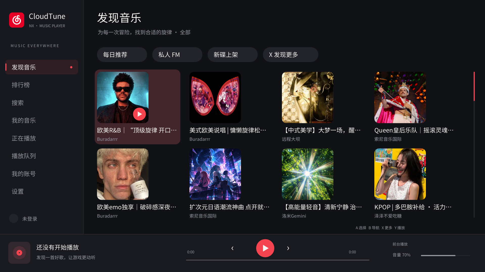
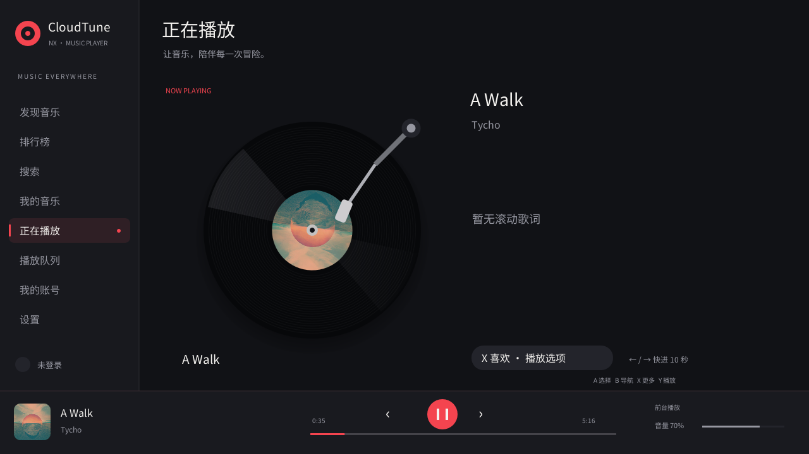

<p align="center"></p>
<h1 align="center">CloudTune NX</h1>

<p align="center">
  在掌心，听见热爱。<br>
  面向 Nintendo Switch 自制系统的原生网易云音乐客户端。
</p>

<p align="center">
  <a href="https://github.com/tiansongyu/cloudtune-nx/actions/workflows/ci.yml"></a>
  <a href="https://github.com/tiansongyu/cloudtune-nx/releases"></a>
  
  
  <a href="LICENSE"></a>
  <a href="overlay/vendor/libtesla/LICENSE"></a>
</p>

CloudTune NX 将网易云音乐的发现、搜索、歌单、收藏和歌词带到
Switch 原生界面。以手柄和触摸操作为中心，使用与
[Switify](https://github.com/DomazinUS/Switify) 相同的 Borealis / NanoVG
GUI 机制；服务接口移植自
[netease-cloud-music-gtk](https://github.com/gmg137/netease-cloud-music-gtk)
所使用的 API 库。

项目仓库：[tiansongyu/cloudtune-nx](https://github.com/tiansongyu/cloudtune-nx)。

<p align="center">
  
  
</p>

以上为虚拟桌面中实际运行的同源 Borealis 客户端截图。
Switch NRO 的独立 Eden 运行记录见下方验证报告。

三个独立组件协同工作：

| 组件 | 文件 | 用途 |
| --- | --- | --- |
| 原生客户端 | `CloudTune.nro` | 登录、发现、搜索、收藏、歌单、歌词和黑胶播放器 |
| 后台播放服务 | `exefs.nsp` | 独立完成网络传输、缓存、解码和音频输出 |
| 游戏内覆盖层 | `CloudTune.ovl` | 播放 / 暂停、切歌、进度、音量、随机和循环控制 |

**当前为 0.1.0 开发预览。** 构建、真实匿名 API、桌面音频引擎及模拟器
验证分别记录在 [验证报告](docs/VALIDATION.md) 和
[API 验证记录](docs/API_VALIDATION.md) 中。真实账号登录后的收藏写操作、
Atmosphère 服务与游戏同时运行仍需要实机验收，不能从一次模拟器启动推断通过。

## 下载

在 [GitHub Releases](https://github.com/tiansongyu/cloudtune-nx/releases) 选择版本，
下载 `CloudTuneNX-<版本>-sd.zip` 和同页的 `SHA256SUMS`。
`v0.1.0` 为开发预览，功能与验证范围见 [发布说明](docs/releases/v0.1.0.md)。

以 0.1.0 为例，将两个文件放在同一目录后校验：

```bash
sha256sum --check --ignore-missing SHA256SUMS
```

确认 `CloudTuneNX-0.1.0-sd.zip: OK` 后，**只将 SD 包解压到 SD 卡根目录**。
`-symbols.zip` 用于排查崩溃，`-docs.zip` 用于离线阅读，均留在电脑上。
GitHub 自动提供的 Source code 压缩包是源码，不包含已编译安装文件。
完整步骤见 [安装指南](docs/INSTALLING.md)；每次发布的自动检查可在
[GitHub Actions](https://github.com/tiansongyu/cloudtune-nx/actions) 查看。

## 功能

### 音乐与资料库

- 热门与分类歌单、精品歌单、排行榜、新碟
- 单曲、歌单、专辑、歌手和歌词搜索
- 歌单 / 专辑详情、歌手曲目、电台节目与分页加载
- 每日推荐、私人 FM、心动模式
- 仅二维码扫码登录；保存多个账号，在设置中切换或移除本机会话
- 我喜欢的音乐、创建 / 收藏的歌单、收藏专辑、订阅电台、音乐云盘
- 歌曲喜欢 / 取消喜欢、歌单和专辑收藏、每日签到
- 原生中文界面、封面缓存、网络代理和明确的失败提示

### 为 Switch 设计的播放器

- 播放时以 **33⅓ RPM 旋转的黑胶唱片**，暂停后停在当前角度
- 唱片封面、反光纹理和随播放状态抬起 / 放下的唱臂
- 持续显示的迷你播放器、全屏播放页和逐行同步 LRC 歌词
- 上一首 / 下一首、暂停 / 恢复、跳转、音量、随机和循环
- 自动识别 MP3 / AAC / FLAC；提供标准至 Hi-Res、超清母带等音源质量选项，使用账号实际获准的播放地址

音源质量、文件容器、立体声输出与缓存限制见 [音频格式说明](docs/AUDIO_FORMATS.md)。
- 渐进 HTTPS 下载、边下载边解码、SD 缓存和失效地址刷新
- 安装后台服务后，NRO 将播放交给独立服务；退出 NRO 后服务保持运行
- 再次打开 NRO 时恢复队列及正在播放的封面，不自动打断后台音频
- 未安装服务时自动使用前台音频引擎，界面显示当前播放模式

### AirPlay 1 独立工具

当前开发分支增加局域网 AirPlay 1 音频接收：打开程序后按已保存的偏好启动，
首次使用默认开启，无需登录网易云账号。在「设置 → AirPlay 1 接收」查看实际
设备名、IP 和状态，或关闭接收、断开当前会话。关闭偏好会跨重启保存。

接收与网易云播放共用一个音频输出；投送结束后原曲保留在暂停位置，由用户恢复。
使用新版后台服务时，退出 NRO 后接收服务继续存在；前台模式随 NRO 退出停止。
实现范围、网络要求和待验收项目见 [AirPlay 使用说明](docs/AIRPLAY.md)。
真实 iPhone 到 Eden 内 NRO 的投送已确认正常出声；Switch 实机游戏内接收仍需验证。
此功能不代表 AirPlay 2 或屏幕镜像支持。

### API 覆盖与接口清单

[API 清单](docs/API_CATALOG.md) 逐项列出 **49 个服务 / 下载方法与 4 个会话辅助方法**，
包括参数、默认值、加密协议、端点和界面调用顺序；同时提供
[机器可读 JSON](docs/api_catalog.json)。
当前保留其中 46 个可调用方法；密码登录、手机号登录及短信发送已移除，
原接口仅在清单中作为参考记录。

底层提供 WEAPI、EAPI 和 XEAPI，采用 libcurl + mbedTLS；无需部署 Node.js
API 中转服务器。二维码授权信息、cookie 和签名请求体不写入诊断日志。

## 要求

- 可以运行自制程序的 Nintendo Switch、Atmosphère 和 Homebrew Menu
- 用于在线音乐与首次登录的网络
- 一个网易云音乐账号，用于个人收藏及需要登录的服务
- 可选的 Tesla / Ultrahand 兼容覆盖层加载器

建议按住 **R** 启动一个游戏进入 Homebrew Menu，以完整应用内存运行 NRO。
账号的会员、版权、地区和试听限制由网易云服务决定；本项目不会绕过这些限制。

## 构建

首选 Docker，不需要将 devkitPro 安装到宿主系统：

```bash
# 获取源码
git clone https://github.com/tiansongyu/cloudtune-nx.git
cd cloudtune-nx

# 构建并验证工具链
./scripts/docker-build.sh --smoke

# 构建 NRO、后台服务与覆盖层
./scripts/docker-build.sh

# 可选：宿主协议、模型、持久化与音频集成测试
./scripts/test-host.sh

# 生成 SD 卡部署包、符号包、文档包及 SHA-256 清单
./scripts/package.sh

# 生成版本固定的 Release 附件（dist/release/）
./scripts/package.sh --release
```

镜像固定到官方 devkitPro digest。编译器和依赖版本记录在
`build/validation/toolchain-packages.txt`。第三方来源和许可证在仓库中记录；
外部源码由构建脚本按固定版本和 SHA-256 获取。
默认镜像为 `cloudtune-nx/toolchain:local`；设置 `CLOUDTUNE_IMAGE` 可指定其他镜像，
旧变量 `NETEASE_SWITCH_IMAGE` 仍兼容，新变量优先。

| 构建产物 | 路径 |
| --- | --- |
| NRO | `build/switch/CloudTune.nro` |
| 匹配的应用 ELF | `build/switch/CloudTune.elf` |
| 后台服务 | `build/switch/background/cloudtune-background.nsp` |
| 匹配的服务 ELF | `build/switch/background/cloudtune-background.elf` |
| 覆盖层与匹配 ELF | `build/overlay/CloudTune.ovl`、`build/overlay/CloudTune.elf` |
| 本地时间戳安装包 | `dist/CloudTuneNX-*` |
| Release 附件与校验文件 | `dist/release/` |

详见 [构建文档](docs/BUILDING.md)，包括独立宿主依赖、桌面构建和测试命令。
PR、`main` 和手工触发的 CI 运行宿主测试与 Switch 构建；版本标签复用同一 CI，
全部通过后自动发布。版本规则、目录布局和权限说明见 [发布流程](docs/RELEASING.md)。

## 安装

将生成的 SD 卡包解压到 SD 卡根目录：

```text
sdmc:/
├── switch/
│   ├── CloudTune/CloudTune.nro
│   └── .overlays/CloudTune.ovl
├── atmosphere/contents/42000000004E434D/
│   ├── exefs.nsp
│   ├── toolbox.json
│   └── flags/boot2.flag
└── config/netease-switch/
    └── cacert.pem
```

**已有会话兼容：** CloudTune NX 继续使用 `config/netease-switch/` 保存登录会话、
设置、队列与缓存；更名无需移动或删除这个目录。后台 IPC `ncm:bg` 和程序 ID
`42000000004E434D` 保持兼容。由旧预览版更新的处理见 [安装指南](docs/INSTALLING.md#updates)。

1. 安装后重启，使 Atmosphère 发现新增的后台程序。
2. 通过 Homebrew Menu 打开 **CloudTune NX**。
3. 进入「我的账号」，生成二维码，并用网易云音乐手机 App 扫描及确认。
4. 进入「我的音乐」查看歌单与收藏，选择歌曲播放。
5. 播放栏显示 **BGM · 后台服务** 后，可退出 NRO，再打开游戏。
6. 使用你的覆盖层加载器打开 **CloudTune NX**，控制正在播放的音乐。

**“前台播放”意味着音频仍属于 NRO 进程。** 此模式不会在退出应用后继续播放。
不要将 `.ovl` 本身当成后台音频服务。

安装包默认通过 `boot2.flag` 在开机时启动后台服务，不会自动播放网易云队列。
带 AirPlay 工具的构建会按保存的接收开关监听局域网投送，首次默认开启。
移除该标记并重启可关闭开机启动；NRO 仍会尝试按需启动服务。
安装包布局、启动方式、更新步骤和排错见
[安装指南](docs/INSTALLING.md)。

## 操作

| 操作 | Switch | 桌面调试 |
| --- | --- | --- |
| 移动焦点 | 方向键 / 左摇杆 | 方向键 |
| 选择 / 播放 | A | Enter |
| 返回 / 侧栏 | B | Escape / Tab |
| 页面选项、分类与收藏 | X | X |
| 播放 / 暂停 | Y | Space |
| 上一首 / 下一首 | L / R | 触摸播放栏 |
| 调低 / 调高音量 | ZL / ZR | 播放页上下方向键 |
| 打开黑胶播放器 | + | P |
| 搜索输入 | 搜索页 A | F |
| 播放页前后跳转 | 左 / 右，10 秒 | 左 / 右 |
| 退出应用 | − 或设置页 | 设置页 |

支持触摸侧栏、卡片、曲目、播放按钮与进度条。搜索和代理使用 Borealis 的平台输入法；
登录统一使用网易云音乐手机 App 扫码，不提供密码或短信验证码入口。

在「设置 → 账号管理」选择「扫码添加账号」，授权后保存会话；再次打开账号管理即可
切换已保存账号。切换时清空原账号的队列和资料库，再加载所选账号的收藏。
「从本机移除」只移除该账号的本地会话，不注销网易云账号，也不会移除其他已保存账号。
详见 [多账号与二维码登录](docs/ACCOUNTS.md)。

设置页包含账号管理、音质、网络代理、AirPlay 1 接收、停止播放和退出应用。AirPlay 对话框的
「关闭接收」会停止监听并保存偏好；「断开当前会话」只结束当前投送，保留接收开关。
若提示更新后台服务，请同步更新安装包中的 `exefs.nsp` 并重启，再检查实际状态。

## 模拟器与实机验证

[Eden](https://git.eden-emu.dev/eden-emu/eden/releases) 用于运行实际 Switch NRO；
桌面 Borealis 版本用于快速调试相同界面和播放器。两者运行在独立虚拟桌面中。
宿主数据目录可通过 `CLOUDTUNE_DATA` 指定，并兼容旧变量 `NETEASE_SWITCH_DATA`
（新变量优先）。Eden 现有 `~/.local/share/netease-switch/eden/` 配置保持原位，
以保留当前模拟器会话。

```bash
./scripts/install-eden.sh
./scripts/eden-virtual-desktop.sh --cli -g "$PWD/build/switch/CloudTune.nro"
```

完整配置、日志和截图位置见 [模拟器调试](docs/EMULATOR.md)。
运行本项目自制 NRO 不需要从第三方下载主机密钥或固件。

覆盖层另有 [Linux 桌面预览](docs/OVERLAY_PREVIEW.md)，复用实际覆盖层 UI，
连接独立音频测试进程，支持中文、旋转黑胶和播放控制：

```bash
python3 scripts/overlay-preview.py
```

首次启动使用生成的本地音频并静音。关闭窗口后播放器继续运行；
用 `python3 scripts/overlay-preview.py --stop` 结束本次预览及播放进程。

模拟器不等同于运行 Atmosphère 的真实 Switch。游戏内后台混音、系统休眠、
蓝牙耳机、底座切换和资源占用使用 [实机验收表](docs/HARDWARE_TESTING.md) 检查。
问题报告请附相同构建的 ELF 对应信息和已脱敏日志。

## 已知边界

- 文件播放器支持 MP3、AAC 和 FLAC，按内容选择解码器。高位深 / 高采样率音源会转换为
  当前统一的立体声 16-bit / 48 kHz 输出；Hi-Res 选项不代表原位深直通或多声道输出。
  服务返回的版权、会员、地区、试听限制仍然生效。AirPlay 的 ALAC / PCM 接收为独立路径。
- 单次后台队列最多 512 首，用于限制常驻内存。大型远程歌单仍可浏览，
  播放时按当前曲目所在的 512 首窗口传递。
- 部分歌曲未登录时仅提供试听，或没有可播放地址；界面遵守服务返回的权限。
- 动态端点来自开源客户端的协议实现，网易服务变更可能需要适配。
- GTK 的 MPRIS、Linux 托盘和桌面歌词插件没有对应的 Switch 平台功能；
  覆盖层承担游戏内播放控制。
- AirPlay 工具面向同一局域网中的单一音频发送端，不支持 AirPlay 2、多房间同步、
  屏幕镜像或视频投送；休眠期间持续接收未实现或验证。

## 项目结构

```text
src/                    原生 GUI、应用模型、API 与加密实现
include/netease/        公共模型、API、IPC 协议
background/             常驻音频引擎、CMIF 服务、音频集成测试
airplay/                AirPlay 1 接收、服务发现、加密与 ALAC 解码适配
overlay/                独立 Tesla 覆盖层
vendor/                 固定的 Borealis、JSON、二维码依赖
resources/              字体、证书与界面资源
docker/                 Docker 编译环境与 smoke 程序
scripts/                构建、环境、模拟器、打包脚本
tests/                  API 协议向量、模型解析与歌词测试
docs/                   API、架构、开发日志与验证记录
```

架构细节见 [后台播放设计](docs/background/ARCHITECTURE.md)，开发里程碑见
[开发日志](docs/DEVELOPMENT_LOG.md)，本轮修复和审查范围见
[代码审查记录](docs/CODE_REVIEW.md)。

## 贡献与许可证

欢迎在 [GitHub Issues](https://github.com/tiansongyu/cloudtune-nx/issues) 提交可复现的问题、
硬件测试结果和补丁。贡献方式见
[CONTRIBUTING.md](CONTRIBUTING.md)，凭据处理见 [SECURITY.md](SECURITY.md)。

应用和后台引擎为 **GPL-3.0-or-later**；独立覆盖层为 **GPL-2.0-only**。
共享 C 协议与客户端采用 GPL-2.0-or-later，以支持两个独立组件。
第三方许可证及来源见 [THIRD_PARTY_NOTICES.md](THIRD_PARTY_NOTICES.md)。

感谢 Switify 作者 HiroshiYamauchi、netease-cloud-music-gtk / API 作者 gmg137，
以及 Borealis、libnx、devkitPro、libtesla、dr_libs 和其他依赖的维护者。

这是独立、非官方的开源项目，与网易、Nintendo 或 Spotify 没有关联。
相关名称和商标归各自所有者。
